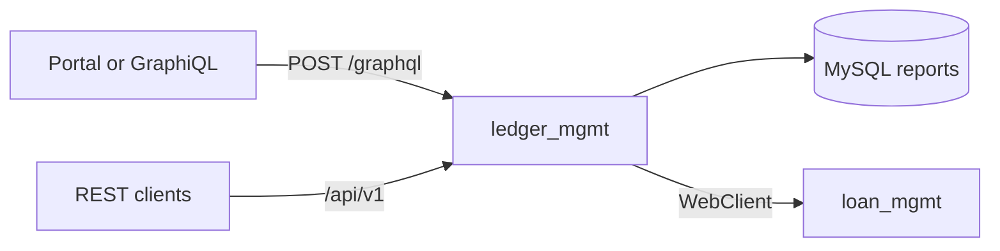
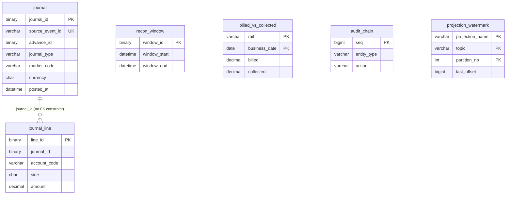

# Airtime-lms-loan---Ledger-SoC

   # LMS General Ledger

`ledger_mgmt` is the accounting system of record for the loan platform. It stores balanced journals in MySQL and exposes them through a small GraphQL read API. Writes (posting a journal, opening a recon window, recording billed versus collected, appending the audit chain, and ingesting loan events) stay on REST.

The service does not own the loan. `loan_mgmt` does. When a loan event should hit the books, it is written to that service's outbox. This service pulls unpublished `accounting.events` and posts a journal. The back-office portal in `frontend` reads the ledger over GraphQL.

## What it is for

Operators and downstream screens need one place to see what was posted: which advance, which journal type, which accounts moved, and whether debits equal credits. The ledger is that place. The chart of accounts lives here, not in loan management.

GraphQL is used only for reads. `reportingData` and `accountLedgerRecords` return several related record sets in one request (journals and lines, recon windows, billed versus collected, the audit chain, watermarks, and an optional loan context). Commands stay on REST because they are single writes with validation and idempotency, and they are not shaped as a graph.

There is no server-side General Ledger report. Debit totals, credit totals, net balance, and a per-account running balance are computed in the portal from the journals this API returns. See [What is not implemented](#what-is-not-implemented).

## Technology stack

| Technology | Where | Role |
|---|---|---|
| Java 21 | `ledger_mgmt/pom.xml` | Language level |
| Spring Boot 3.4.5 | parent POM | Application runtime |
| Spring Web (servlet) | `spring-boot-starter-web` | REST controllers. `spring.main.web-application-type=servlet` |
| Spring for GraphQL | `spring-boot-starter-graphql` | Schema and `@QueryMapping` reads. No mutations |
| Spring Data JPA / Hibernate | `spring-boot-starter-data-jpa` | Entities and derived repository queries. MySQL dialect |
| Bean Validation | `spring-boot-starter-validation` | REST request constraints |
| Spring WebFlux `WebClient` | `spring-boot-starter-webflux` | HTTP client to `loan_mgmt` only. The server is not reactive |
| MySQL Connector/J | runtime | Driver for MySQL 8 |
| Maven | `pom.xml` | Build and `spring-boot-maven-plugin` |
| JUnit 5 | `spring-boot-starter-test` | Unit tests in `ChartTest` |
| React 18, TypeScript, Vite, MUI | `frontend` | Portal that calls `/graphql` |

Postman is not part of this repository. There is no checked-in collection. GraphiQL is enabled and is the built-in way to run queries.

Jackson is configured to write dates as ISO strings in UTC and to omit null properties. That applies to REST. GraphQL fields are strings assembled in `LedgerReportService`.

## Architecture

Reads:

```text
GraphQL client
  -> POST /graphql
  -> LedgerReportController (@QueryMapping)
  -> LedgerReportService
  -> JournalService and Spring Data repositories
  -> MySQL database `reports`
```

If `accountLedgerRecords` is called with `subscriberRef`, `LedgerReportService` also calls `loan_mgmt`:

```text
LedgerReportService
  -> LoanMgmtClient (WebClient)
  -> GET /api/v1/internal/subscribers/{subscriberRef}/context
```

Writes and ingest:

```text
HTTP client
  -> /api/v1/*
  -> LedgerController
  -> JournalService | ReportingCommandService | AccountingIngestService
  -> MySQL `reports`
```

Ingest additionally reads `GET /api/v1/internal/outbox?topic=accounting.events` and then `POST /api/v1/internal/outbox/{outboxId}/published` on loan management.



Journals are loaded by `JournalRepository`, then lines by `JournalLineRepository.findByJournalId`. There is no JPA association between `Journal` and `JournalLine`. The link is the `journal_id` column, loaded in the service. Lines in a response are ordered debit first, then credit, then by account code. Journals are ordered by `posted_at` ascending.

Every GraphQL list is capped at 500 rows in `LedgerReportService`.

## Project structure

```text
ledger_mgmt/
  pom.xml
  src/main/java/com/lms/ledger/
    LedgerMgmtApplication.java
    api/
      LedgerController.java          REST writes and journal fetch
      RestExceptionHandler.java      REST error body
      ApiException.java
    graphql/
      LedgerReportController.java    Query mappings
      LedgerReportService.java       Read assembly and the 500-row cap
    service/
      JournalService.java            Post, idempotent replay, find
      AccountingIngestService.java   Pull unpublished accounting events
      ReportingCommandService.java   Recon, billed, audit, watermarks
    repo/                            Spring Data JPA, derived methods only
    domain/
      Chart.java                     Journal type to debit/credit lines
      JournalBalancer.java           DR = CR check
      entity/                        Journal, JournalLine, ReconWindow,
                                     BilledVsCollected, AuditChain,
                                     ProjectionWatermark
    client/LoanMgmtClient.java
  src/main/resources/
    application.properties
    graphql/ledger.graphqls          Schema. Default location classpath:graphql/
  src/test/java/com/lms/ledger/domain/ChartTest.java
lms_ledger_schema.sql                 Database `reports`
frontend/                             Portal. Trial balance is calculated here
loan_mgmt/                            Upstream loan system of record
```

`Chart` is Java, not a database table. Account codes are constants: `FEE_RECEIVABLE`, `FEE_INCOME`, `PRINCIPAL_RECEIVABLE`, `WRITE_OFF_EXPENSE`, `CASH_RECOVERY`, `RECOVERY_OF_WRITE_OFF`.

## Account ledger

Query: `accountLedgerRecords`.

Purpose: return posted journals and their lines, optionally narrowed to one advance, to every advance of one subscriber, or to one market. This is the account-ledger feed. It is not a per-account statement and it does not return a running or closing balance.

Arguments, all optional:

| Argument | Behavior |
|---|---|
| `advanceId` | When set, only that advance. `marketCode` is ignored. Value must be a UUID. |
| `subscriberRef` | Used only when `advanceId` is blank. The ledger asks loan management for that subscriber's advances and returns journals for those advance ids. If the lookup fails, the journal list is empty. |
| `marketCode` | Used only when both `advanceId` and `subscriberRef` are blank. Filters `journal.market_code`. |

Sort: `posted_at` ascending. At most 500 journals. There is no date-range argument, account-code filter, or offset.

`loanContextStatus` is one of:

| Value | Meaning |
|---|---|
| `NOT_REQUESTED` | `subscriberRef` was omitted |
| `LOAN_MGMT_URL_UNSET` | `loan-mgmt.base-url` is blank |
| `OK` | Context was loaded |
| `UNREACHABLE` | The loan call threw |

`loanContext` is null unless the status is `OK`.

Each record contains `journalId`, `sourceEventId`, `advanceId`, `journalType`, `marketCode`, `currency`, `postedAt`, and `lines` (`lineId`, `accountCode`, `side`, `amount`). `side` is `DR` or `CR`. Amounts are decimal strings.

The portal's Account Ledger screen then filters those lines to one account code and computes a running balance locally (`frontend/src/lib/derive.ts`). That screen is not a separate API.

## General ledger report

Not implemented on the server.

There is no query, REST resource, or SQL view that returns debit totals, credit totals, or a closing balance for an account over a date range. `reportingData` is a different report: recon windows, billed versus collected, the audit chain, and projection watermarks. It does not group journal lines by account.

The portal's Trial Balance page builds that view in the browser from `accountLedgerRecords`:

- Include journals whose posting day is on or before an "as of" date.
- Sum debits and credits per `accountCode`.
- Net is debit minus credit for accounts whose normal side is `DR`, and credit minus debit for accounts whose normal side is `CR`.
- The page checks that the column totals are equal.

Normal sides are defined in `frontend/src/types.ts`, not in MySQL. There is no from-date, and the net figure is not stored.

## GraphQL API

Endpoint: `POST /graphql`. GraphiQL: `GET /graphiql` on the ledger port (5000 by default).

Schema file: `ledger_mgmt/src/main/resources/graphql/ledger.graphqls`. Spring GraphQL loads `classpath:graphql/**/*.graphqls`. The path is not overridden in properties.

There are two queries and no mutations.

### `accountLedgerRecords`

```graphql
query AccountLedger($advanceId: ID, $subscriberRef: String, $marketCode: String) {
  accountLedgerRecords(
    advanceId: $advanceId
    subscriberRef: $subscriberRef
    marketCode: $marketCode
  ) {
    loanContextStatus
    loanContext {
      subscriberRef
      advances {
        advanceId
        status
        currency
        dueDate
        principalResidual
        feeResidual
        allocations { component seq amount }
      }
    }
    records {
      journalId
      sourceEventId
      advanceId
      journalType
      marketCode
      currency
      postedAt
      lines { lineId accountCode side amount }
    }
  }
}
```

Variables for one market, with no loan lookup:

```json
{ "marketCode": "DEV" }
```

Response shape when no subscriber was requested. Values depend on the database.

```json
{
  "data": {
    "accountLedgerRecords": {
      "loanContextStatus": "NOT_REQUESTED",
      "loanContext": null,
      "records": [
        {
          "journalId": "018f3b2a-7c21-7000-8000-000000000001",
          "sourceEventId": "outbox:1",
          "advanceId": "018f3b2a-7c21-7000-8000-0000000000aa",
          "journalType": "FEE_REVENUE",
          "marketCode": "DEV",
          "currency": "XXX",
          "postedAt": "2026-10-17T08:00:00",
          "lines": [
            { "lineId": "018f3b2a-7c21-7000-8000-000000000010", "accountCode": "FEE_RECEIVABLE", "side": "DR", "amount": "7.5000" },
            { "lineId": "018f3b2a-7c21-7000-8000-000000000011", "accountCode": "FEE_INCOME", "side": "CR", "amount": "7.5000" }
          ]
        }
      ]
    }
  }
}
```

A blank call (`accountLedgerRecords` with no arguments) returns every journal, still capped at 500, with `loanContextStatus` `NOT_REQUESTED`.

### `reportingData`

Optional `rail` filters billed-versus-collected rows. Recon windows, the audit chain, and watermarks are not filtered by `rail`. Each list is capped at 500. Order is window start, business date, audit sequence, then projection name.

```graphql
query Reporting($rail: String) {
  reportingData(rail: $rail) {
    reconWindows {
      windowId
      windowStart
      windowEnd
      quotedTotal
      ingestedTotal
      postedTotal
      filteredCount
      breakCount
      exceptionOwner
    }
    billedVsCollected { rail businessDate billed collected }
    auditChain {
      seq
      entityType
      entityId
      action
      payloadHash
      prevHash
      chainHash
      createdAt
    }
    watermarks { projectionName topic partitionNo lastOffset updatedAt }
  }
}
```

```json
{ "rail": "AIRTIME" }
```

Omit `rail` or send null to return every billed row.

Hash fields are lowercase hex of the stored `BINARY(32)` columns. `filteredCount` and `seq` are strings, not integers. `breakCount` and `partitionNo` are integers.

There is no General Ledger report operation to call.

## Journal posting rules

`Chart.lines` builds lines from a journal type:

| `journalType` | Lines |
|---|---|
| `FEE_REVENUE` | DR `FEE_RECEIVABLE`, CR `FEE_INCOME` for the fee, or for `amount` when the fee is zero |
| `WRITE_OFF` | DR `WRITE_OFF_EXPENSE` for principal plus fee. CR `PRINCIPAL_RECEIVABLE` and CR `FEE_RECEIVABLE` for the parts that are positive |
| `RECOVERY_OF_WRITTEN_OFF` | DR `CASH_RECOVERY`, CR `RECOVERY_OF_WRITE_OFF` |
| anything else | Rejected as `JOURNAL_TYPE_UNSUPPORTED` |

`JournalBalancer` requires at least one line, side `DR` or `CR`, a positive amount, and equal debit and credit totals. An empty chart result (all amounts zero) is skipped during ingest and is not posted.

`POST /api/v1/journals` accepts caller-supplied lines and applies the same balance check. It does not rebuild lines from the journal type.

`source_event_id` is unique. A second post with the same id returns the existing journal and HTTP 200. A new journal returns HTTP 201.

Ingest (`POST /api/v1/accounting/ingest`) maps a missing payload `journalType` from the outbox `eventType`. `FEE_BOOKED` becomes `FEE_REVENUE`. Other event types are used as the journal type. After each event it records an ingest watermark and marks the outbox row published, including events that were skipped or already booked.

Other REST writes, all under `/api/v1`:

| Method | Path | Effect |
|---|---|---|
| `GET` | `/journals/{journalId}` | One journal and its lines. `404` `JOURNAL_NOT_FOUND` when missing |
| `POST` | `/recon-windows` | Insert a recon window |
| `POST` | `/billed-vs-collected` | Insert or update billed and collected for a rail and business date |
| `POST` | `/audit-chain` | Append a hash-linked audit row |
| `PUT` | `/watermarks` | Insert or update a projection watermark |

REST failures use `{"code","message"}`. Validation errors use `VALIDATION_FAILED`. Unreadable JSON uses `MALFORMED_JSON`. A uniqueness or check failure uses `409` `CONSTRAINT_VIOLATION`. Known ledger errors use `ApiException` (`UNBALANCED_JOURNAL`, `PAYLOAD_FAILED`, `JOURNAL_TYPE_REQUIRED`, and the codes above).

GraphQL has no matching exception handler. An `advanceId` that is not a UUID fails inside `UUID.fromString` before a data payload is built.

## Database

Schema script: `lms_ledger_schema.sql`. It creates database `reports` (`utf8mb4`, `utf8mb4_0900_ai_ci`, InnoDB). Hibernate does not create or alter tables (`ddl-auto=none`).

Money columns are `DECIMAL(19,4)`. Identifiers on journals, lines, and recon windows are `BINARY(16)` UUIDs. The JPA converter maps those to `java.util.UUID`.

| Table | Responsibility | Key |
|---|---|---|
| `journal` | One posted document: source event, advance, type, market, currency, `posted_at` | PK `journal_id`. Unique `source_event_id` |
| `journal_line` | One debit or credit. `side` is checked as `DR` or `CR` | PK `line_id`. Index on `journal_id` |
| `recon_window` | Quoted, ingested, and posted totals for a time window, plus a break count | PK `window_id` |
| `billed_vs_collected` | Billed and collected amounts for a rail on a business date | PK (`rail`, `business_date`) |
| `audit_chain` | Append-only hash chain. `chain_hash` is SHA-256 of the previous hash and the payload hash | PK `seq` |
| `projection_watermark` | Last consumed offset for a projection, topic, and partition | PK (`projection_name`, `topic`, `partition_no`) |

`journal` has no status column. A row exists only after it is posted. `posted_at` is the posting timestamp (`DATETIME(6)`), not a separate posting-date type. There is no foreign key from `journal_line.journal_id` to `journal.journal_id`. The application treats that column as the parent id. Account codes are not a table.



`advance_id` points at a loan in `loan_mgmt`. That database is separate. This schema does not declare a cross-database foreign key.

## Prerequisites and startup

- JDK 21
- Maven
- MySQL 8 listening on the host in `spring.datasource.url` (the checked-in file uses `localhost:3306`)

Create the schema before the first start. The application will not create it.

```bash
mysql -u <user> -p -e "CREATE DATABASE IF NOT EXISTS reports CHARACTER SET utf8mb4 COLLATE utf8mb4_0900_ai_ci;"
mysql -u <user> -p reports < lms_ledger_schema.sql
```

Set the datasource user and password in `ledger_mgmt/src/main/resources/application.properties`, or override them with environment variables. Spring Boot relaxed binding accepts `SPRING_DATASOURCE_USERNAME` and `SPRING_DATASOURCE_PASSWORD`. Do not commit real passwords.

`loan-mgmt.base-url` must be set before ingest or before any `accountLedgerRecords` call that passes `subscriberRef`. Journal reads that do not pass `subscriberRef` do not call loan management. The checked-in value is `http://localhost:5001`, which is `loan_mgmt`'s port.

```bash
cd ledger_mgmt
mvn spring-boot:run
```

The process is up when the log reports the servlet port and GraphiQL is reachable:

- GraphiQL: `http://localhost:5000/graphiql`
- GraphQL: `POST http://localhost:5000/graphql` with `Content-Type: application/json` and a body `{"query":"{ reportingData { watermarks { projectionName } } }"}`

An empty database returns empty lists, not an error.

The portal, if you run it, must proxy GraphQL at this service. From `frontend`:

```bash
LEDGER_URL=http://127.0.0.1:5000 npm run dev
```

`frontend/vite.config.ts` otherwise defaults `LEDGER_URL` to `http://127.0.0.1:8082`, which is not this service's port.

## Configuration

File: `ledger_mgmt/src/main/resources/application.properties`. There is no `application.yml` and no logging configuration.

| Property | Checked-in meaning |
|---|---|
| `spring.application.name` | `ledger_mgmt` |
| `server.port` | `5000` |
| `spring.datasource.url` | `jdbc:mysql://localhost:3306/reports` |
| `spring.datasource.username` | Set locally. Do not commit a shared password |
| `spring.datasource.password` | Set locally or with `SPRING_DATASOURCE_PASSWORD` |
| `spring.datasource.driver-class-name` | `com.mysql.cj.jdbc.Driver` |
| `spring.jpa.hibernate.ddl-auto` | `none` |
| `spring.jpa.open-in-view` | `false` |
| `spring.jpa.properties.hibernate.dialect` | `org.hibernate.dialect.MySQLDialect` |
| `spring.jpa.properties.hibernate.jdbc.time_zone` | `UTC` |
| `spring.jackson.time-zone` | `UTC` |
| `spring.jackson.serialization.write-dates-as-timestamps` | `false` |
| `spring.jackson.default-property-inclusion` | `non_null` |
| `loan-mgmt.base-url` | Base URL of loan management. No trailing-path logic beyond stripping a trailing slash |
| `spring.main.web-application-type` | `servlet` |
| `spring.graphql.graphiql.enabled` | `true` |
| `spring.graphql.cors.allowed-origin-patterns` | `http://localhost:*` and `http://127.0.0.1:*` |
| `spring.graphql.cors.allowed-methods` | `GET,POST,OPTIONS` |
| `spring.graphql.cors.allowed-headers` | `*` |

GraphQL schema location is the Spring default, `classpath:graphql/`.

```properties
spring.datasource.url=jdbc:mysql://localhost:3306/reports
spring.datasource.username=${SPRING_DATASOURCE_USERNAME}
spring.datasource.password=${SPRING_DATASOURCE_PASSWORD}
loan-mgmt.base-url=http://localhost:5001
```

## Testing

Automated coverage is one unit test class, `ChartTest`. It checks fee-revenue lines, a balanced write-off, and rejection of an unbalanced pair. It does not start Spring, MySQL, or GraphQL.

```bash
cd ledger_mgmt
mvn test
```

Manual check in GraphiQL (`http://localhost:5000/graphiql`):

```graphql
query {
  accountLedgerRecords(marketCode: "DEV") {
    loanContextStatus
    records {
      journalType
      postedAt
      lines { accountCode side amount }
    }
  }
}
```

```graphql
query {
  reportingData {
    billedVsCollected { rail businessDate billed collected }
    reconWindows { windowId breakCount postedTotal }
  }
}
```

A successful body has a `data` object and the fields above. It will not contain debit totals or a closing balance. Those are not in the schema.

To exercise a write, post a balanced journal and read it back with `GET /api/v1/journals/{journalId}` or `accountLedgerRecords`. Sending unequal debits and credits returns HTTP 400 `UNBALANCED_JOURNAL`.

## What is not implemented

Confirmed by reading the schema, services, repositories, and tests:

- No General Ledger report query, and no stored closing balance.
- No GraphQL filter by account code or posting-date range. Date cutting exists only in the portal.
- No pagination. Each list stops at 500 rows with no cursor or total count.
- `marketCode` is ignored when `advanceId` or `subscriberRef` is also set.
- No GraphQL mutations. Posting is REST.
- No authentication or authorization on REST or GraphQL.
- No GraphQL-specific exception mapping.
- No JPA relationship or database foreign key between journal and journal line.
- No custom `@Query` SQL. Repositories use derived method names.
- No integration test that boots the application or hits MySQL.
- No Postman collection in the repo.
- Account codes are not validated against `Chart` on a manual `POST /journals`. Any non-blank code can be stored if the entry balances.
- Ingest depends on `loan_mgmt` being reachable. A failed loan call is not given a dedicated retry API beyond calling ingest again. Already published events are not returned by the unpublished outbox read.

Reasonable next steps, none of which exist in the code today: cursor pagination past the 500-row cap, a real general-ledger query that aggregates by account and date in the database, a foreign key from `journal_line` to `journal`, auth in front of GraphQL and the write API, and a `@SpringBootTest` against the schema.
