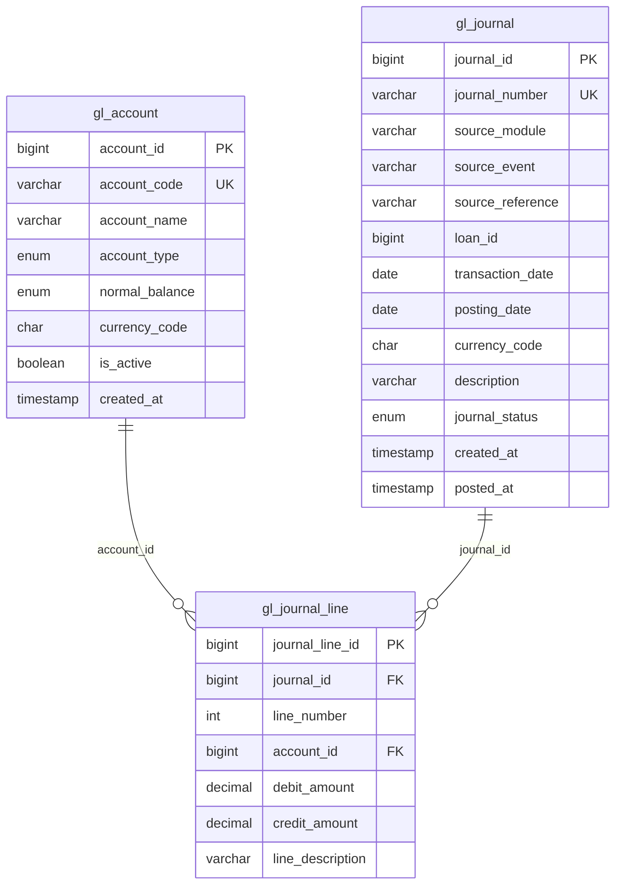

# Airtime-lms-loan---Ledger-SoC

## LMS General Ledger API

Read-only API for a loan-management general ledger. It exposes chart-of-accounts data over REST and two GraphQL queries: an account ledger and a date-ranged general ledger report. Both queries read journal lines from MySQL through Spring Data JPA.

GraphQL is used for the ledger views because a client can ask for only the fields it needs from a nested report (header totals plus line records) in one request. Account lookup stays on REST because those calls return a fixed account resource.

This is a learning application. It does not post journals, enforce authentication, or calculate a true book balance.

## Technology stack

| Technology | Version / artifact | Role |
| --- | --- | --- |
| Java | 21 (`java.version` in `pom.xml`) | Language |
| Spring Boot | 4.1.1 parent | Application runtime |
| Spring Web | `spring-boot-starter-web` | REST controllers and embedded Tomcat |
| Spring for GraphQL | `spring-boot-starter-graphql` | Schema-first GraphQL at `POST /graphql` |
| Spring Data JPA / Hibernate | `spring-boot-starter-data-jpa` | Entities, repositories, JPQL |
| MySQL Connector/J | `mysql-connector-j` (Boot-managed) | JDBC driver |
| Maven | `pom.xml`, `mvnw` / `mvnw.cmd` | Build and run |

Postman is not part of the build. Use it, curl, or GraphiQL to call the API. There is no test dependency and no `src/test` tree.

The compiler plugin references Lombok, but Lombok is not a dependency and the source does not use it.

## Architecture

```text
REST client  → GlAccountController → GlAccountService → GlAccountRepository → MySQL
GraphQL      → @QueryMapping       → service          → GlJournalLineRepository → MySQL
```

`spring.jpa.open-in-view` is `false`. GraphQL and REST handlers return DTOs, not JPA entities. Read methods run inside `@Transactional(readOnly = true)`.

```text
src/main/java/in/graphQL/
  ApiApplication.java
  controller/
    GlAccountController.java              REST /api/gl-accounts
    GlLedgerController.java               GraphQL accountLedger
    GeneralLedgerReportResolver.java      GraphQL generalLedgerReport
  service/
    GlAccountService.java
    GlLedgerService.java
    GeneralLedgerReportService.java
  repository/
    GlAccountRepository.java
    GlJournalLineRepository.java
  entity/
    GlAccount.java
    GlJournal.java
    GlJournalLine.java
  dto/
    GlAccountResponse.java
    LedgerEntryResponse.java
    GeneralLedgerReportResponse.java
    JournalLineResponse.java
  DB setup/
    GL_schema_creation.sql
    GL_ledger_data.sql
    Query_Test.sql
src/main/resources/
  application.properties
  graphql/schema.graphqls
```

| Layer | Responsibility |
| --- | --- |
| `schema.graphqls` | GraphQL contract. Spring loads `classpath:graphql/**/*.graphqls` by default. |
| Controller / resolver | Maps HTTP or GraphQL arguments to a service call. |
| Service | Maps entities to DTOs and computes report totals. |
| Repository | JPQL. Ledger fetch joins journal and account. |
| Entity | Maps `gl_account`, `gl_journal`, and `gl_journal_line`. |
| DTO | API shape. GraphQL field names follow the record components. |

## Features

### Account ledger (implemented)

GraphQL query `accountLedger`.

- **Input:** required `accountCode`.
- **Behavior:** every journal line for that account. No status filter, so `DRAFT`, `POSTED`, and `REVERSED` journals are included. An unknown code returns an empty list, not an error.
- **Order:** `postingDate`, then `journalNumber`, then `lineNumber`.
- **Description:** line description when present, otherwise the journal description.
- **Amounts:** null debit or credit becomes `0`.
- **Fields:** `journalNumber`, `transactionDate`, `postingDate`, `accountCode`, `accountName`, `description`, `debitAmount`, `creditAmount`.

### General ledger report (implemented, partial balance)

GraphQL query `generalLedgerReport`.

- **Input:** required `accountCode`, `fromDate`, `toDate`. Dates must be `yyyy-MM-dd`.
- **Filter:** `journal.transactionDate` is inclusive. This is the transaction date, not the posting date. Journal status is not filtered.
- **Order:** `transactionDate` ascending only.
- **Totals:** sum of debit and credit on the lines in that range.
- **Closing balance:** `totalDebit - totalCredit` for that range only. The service comment states this is net movement, not a closing balance that includes an opening balance. Account normal balance is not applied.
- **Lines:** `id` (journal line id), `transactionDate`, `debit`, `credit`.
- **Validation:** if `fromDate` is after `toDate`, the service throws `IllegalArgumentException`. There is no `@ControllerAdvice`, so GraphQL reports that as an internal error. An unknown account returns zero totals and an empty `records` list.

`JournalLineResponse.from` exists but is not used. The service builds records inline and passes database amounts through, including a possible null. The SQL script defines those amounts as `NOT NULL`.

### Chart of accounts (implemented, REST)

| Method | Path | Result |
| --- | --- | --- |
| `GET` | `/api/gl-accounts` | All accounts |
| `GET` | `/api/gl-accounts/{accountId}` | One account, or 404 |
| `GET` | `/api/gl-accounts/code/{accountCode}` | One account, or 404 |

Each account returns `accountId`, `accountCode`, `accountName`, `accountType`, `normalBalance`, `currencyCode`, `active`, and `createdAt`.

### Present in SQL, not in the API

`GL_schema_creation.sql` also creates `gl_accounting_period`, `gl_posting_rule`, and `gl_account_balance`. `gl_account.parent_account_id` is in the script and is not mapped on `GlAccount`. No Java code reads those tables. There are no mutations and no journal-posting flow.

## GraphQL API

Endpoint: `POST http://localhost:8080/graphql`  
Header: `Content-Type: application/json`  
GraphiQL: `http://localhost:8080/graphiql` when `spring.graphql.graphiql.enabled=true`.

Schema types are `LedgerEntry`, `GeneralLedgerReport`, and `JournalLine`. Java records use different class names; Spring binds by field name.

### `accountLedger`

```graphql
query {
  accountLedger(accountCode: "1100") {
    journalNumber
    transactionDate
    postingDate
    accountCode
    accountName
    description
    debitAmount
    creditAmount
  }
}
```

With the sample journal `JV-2026-00001` loaded, account `1100` looks like this:

```json
{
  "data": {
    "accountLedger": [
      {
        "journalNumber": "JV-2026-00001",
        "transactionDate": "2026-10-16",
        "postingDate": "2026-10-16",
        "accountCode": "1100",
        "accountName": "Loan Principal Receivable",
        "description": "Loan principal receivable",
        "debitAmount": 100000.0,
        "creditAmount": 0.0
      }
    ]
  }
}
```

The schema types amounts as `Float`. Values are stored as `DECIMAL(19,4)`.

### `generalLedgerReport`

```graphql
query {
  generalLedgerReport(
    accountCode: "1100"
    fromDate: "2026-10-01"
    toDate: "2026-10-31"
  ) {
    accountCode
    totalDebit
    totalCredit
    closingBalance
    records {
      id
      transactionDate
      debit
      credit
    }
  }
}
```

Sample shape for that same disbursement line:

```json
{
  "data": {
    "generalLedgerReport": {
      "accountCode": "1100",
      "totalDebit": 100000.0,
      "totalCredit": 0.0,
      "closingBalance": 100000.0,
      "records": [
        {
          "id": "1",
          "transactionDate": "2026-10-16",
          "debit": 100000.0,
          "credit": 0.0
        }
      ]
    }
  }
}
```

`id` is the `journal_line_id` generated by MySQL, so it will not always be `1`. `closingBalance` here is period debits minus period credits.

Postman body:

```json
{
  "query": "query ($accountCode: String!, $fromDate: String!, $toDate: String!) { generalLedgerReport(accountCode: $accountCode, fromDate: $fromDate, toDate: $toDate) { accountCode totalDebit totalCredit closingBalance records { id transactionDate debit credit } } }",
  "variables": {
    "accountCode": "1100",
    "fromDate": "2026-10-01",
    "toDate": "2026-10-31"
  }
}
```

There are no mutations.

## Database

Configured database name: `lms_gl`.

The application maps three tables:



`journal_status` is `DRAFT`, `POSTED`, or `REVERSED`. The sample script inserts `JV-2026-00001` as `DRAFT`. Queries do not exclude drafts.

`GlJournalLine.journal` and `GlJournalLine.account` are lazy `@ManyToOne` links. `findAllLedgerEntries` uses `JOIN FETCH` for both. `findReportRecords` joins them for filtering but does not fetch the journal, so the report loads each journal lazily inside the service transaction.

`account_type` is `ASSET`, `LIABILITY`, `EQUITY`, `INCOME`, or `EXPENSE`. `normal_balance` is `DEBIT` or `CREDIT`.

Tables created by the SQL script and unused by JPA: `gl_accounting_period`, `gl_posting_rule`, `gl_account_balance`. Hibernate `ddl-auto=validate` checks mapped columns. It does not create or drop tables.

## Local setup

1. Install JDK 21 and MySQL, and start MySQL.
2. Create the schema and sample data. The scripts live under `src/main/java/in/graphQL/DB setup/`:

```bash
mysql -h 127.0.0.1 -P 3306 -u root -p < "src/main/java/in/graphQL/DB setup/GL_schema_creation.sql"
mysql -h 127.0.0.1 -P 3306 -u root -p < "src/main/java/in/graphQL/DB setup/GL_ledger_data.sql"
```

3. Point `src/main/resources/application.properties` at that database. Do not commit a real password.
4. From the project root:

```bash
./mvnw spring-boot:run
```

5. Startup is successful when the log shows Tomcat on port 8080 and `GraphQL endpoint HTTP POST /graphql`. `Started ApiApplication` is the final line. If validation fails, the mapped tables are missing or their columns do not match the entities.

Sample accounts from the seed script include `1100`, `1110`, `1200`, `2100`, `4100`, `4200`, `5100`, and `5200`.

## Configuration

`src/main/resources/application.properties`:

| Property | Current meaning |
| --- | --- |
| `spring.application.name` | `Api` |
| `server.port` | `8080` |
| `spring.datasource.url` | `jdbc:mysql://127.0.0.1:3306/lms_gl` plus local driver flags |
| `spring.datasource.username` | Database user |
| `spring.datasource.password` | Database password. Replace with an environment-specific value. |
| `spring.datasource.driver-class-name` | `com.mysql.cj.jdbc.Driver` |
| `spring.jpa.hibernate.ddl-auto` | `validate` |
| `spring.jpa.show-sql` | `true` (SQL printed to the log) |
| `spring.jpa.open-in-view` | `false` |
| `spring.graphql.graphiql.enabled` | `true` |

The URL in the repo sets `allowPublicKeyRetrieval=true` and `useSSL=false` for a local MySQL 8 login. Do not copy those flags to a remote database without TLS. No logging level is configured. No `application.yml` exists.

Prefer overriding the password outside the file, for example:

```properties
spring.datasource.password=${DB_PASSWORD}
```

## Testing

No automated tests are checked in. `./mvnw test` compiles the application and runs an empty test suite.

Manual checks:

- GraphiQL at `http://localhost:8080/graphiql`, using the queries above.
- Postman `POST http://localhost:8080/graphql`.
- REST: `GET http://localhost:8080/api/gl-accounts` and `GET http://localhost:8080/api/gl-accounts/code/1100`.

`Query_Test.sql` is a manual SQL script, not a JUnit test.

A query succeeds when the HTTP status is 200 and the JSON has no `errors` array. An empty ledger is still success when the account has no lines.

## Limitations

- Report closing balance ignores opening balance, `gl_account_balance`, and normal balance.
- Ledger and report include every journal status.
- Report sort is transaction date only.
- No pagination.
- No authentication or authorization.
- No custom API error mapping or bean validation.
- Report query does not `JOIN FETCH` the journal.
- `Float` in the GraphQL schema is a lossy view of `DECIMAL(19,4)`.
- Schema and seed SQL are under a Java source directory named `DB setup`, not under `src/main/resources`.
- Only one sample journal is inserted, and it stays `DRAFT`.

## Possible next steps

- Define closing balance with an opening balance and the account's normal balance.
- Restrict financial queries to `POSTED` journals, or accept a status argument.
- Paginate ledger lines.
- Map validation failures to GraphQL errors with a clear message.
- Add authentication before any shared deployment.
- Add integration tests against the schema and the seed journal.
- Fetch the report journal in the same query as the lines.
- Expose posting rules and period balances only if a use case needs them.
